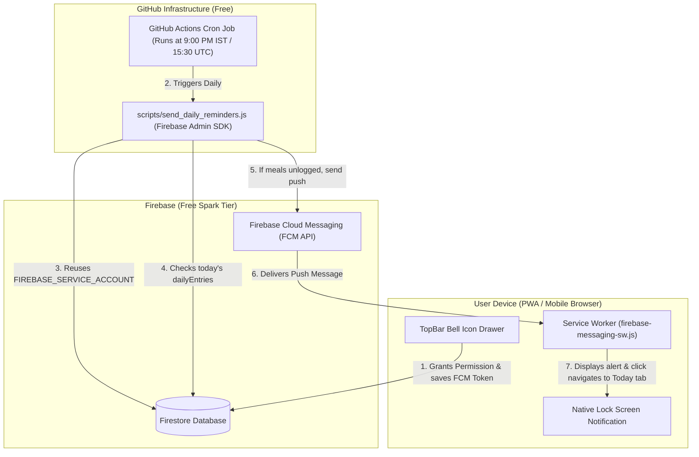

# Implementation Plan: 100% Free Daily 9:00 PM Meal Reminder (Spark Plan)

## 1. Executive Summary & Architecture

This plan delivers a native-feeling, daily 9:00 PM meal reminder for the **Mess Tracker** Progressive Web App (PWA) operating **100% within Firebase's Free Spark tier** (no Blaze plan / paid Cloud Functions required).

We take advantage of your existing GitHub Actions infrastructure (already storing `FIREBASE_SERVICE_ACCOUNT_MESS_TRACKER_8FF02` in repository secrets from commit [`f20c302a`](file:///d:/mess-tracker/.github/workflows/firebase-hosting-merge.yml#L18)) to run a free daily cron job that dispatches web push notifications via **Firebase Cloud Messaging (FCM)**.



---

## 2. Notification Scenarios & Smart Meal Logic

| Scenario | Condition in `dailyEntries/{YYYY-MM-DD}` | Action Taken at 9:00 PM | Message Content |
| :--- | :--- | :--- | :--- |
| **All Logged** | `breakfast: true`, `lunch: true`, `dinner: true` | **Skip** (No push) | None |
| **Dinner Logged** | `dinner: true` (regardless of breakfast/lunch) | **Skip** (No push) | None (User finished their night entry) |
| **Partial Logged** | Breakfast or Lunch recorded, but `dinner: false` | **Send Alert** | *"Did you have dinner tonight? Tap to mark your dinner in Mess Tracker."* |
| **Zero Logged** | Document missing or all meals `false` | **Send Alert** | *"You haven't logged any meals for today. Don't forget to update your mess log!"* |
| **User Paused** | User disabled reminders in Bell settings | **Skip** | None |
| **Invalid Token** | User uninstalled PWA or revoked permission | **Auto-Cleanup** | Script removes dead token from Firestore `fcmTokens` array |

---

## 3. Data Schema in Firestore

Under `users/{uid}/settings/notifications`:
```json
{
  "enabled": true,
  "reminderTime": "21:00",
  "timezone": "Asia/Kolkata",
  "fcmTokens": [
    {
      "token": "eXamPLe-fcm-toKen-...",
      "device": "Android Chrome (PWA)",
      "createdAt": "2026-10-27T12:50:00Z",
      "lastUsed": "2026-10-27T12:50:00Z"
    }
  ],
  "history": [
    {
      "id": "notif_1730043000",
      "title": "Evening Mess Reminder",
      "body": "Did you have dinner tonight?",
      "sentAt": "2026-10-27T15:30:00Z",
      "read": false
    }
  ]
}
```

---

## 4. Exhaustive Edge Cases Analysis & Technical Mitigations

Before writing any code, we have examined every potential edge case across browsers, operating systems, authentication, service workers, and cron scheduling:

### A. Mobile OS & Browser Edge Cases
1. **iOS Safari PWA Constraint:**
   * *Edge Case:* On iPhones (iOS 16.4+), Apple strictly requires the web app to be added to the Home Screen (`display: standalone`) before Web Push notifications can be requested or shown. In standard Safari tabs, the Push API is disabled.
   * *Mitigation:* The Bell UI detects if running on iOS outside standalone mode (`window.navigator.standalone !== true`). Instead of failing silently, it shows a helpful banner: *"To enable notifications on iPhone, tap Share (bottom icon) -> 'Add to Home Screen' first."*
2. **Android Battery Optimization / Doze Mode:**
   * *Edge Case:* Android battery managers can delay background push notifications if sent with normal priority.
   * *Mitigation:* The backend notification payload explicitly specifies `android: { priority: 'high' }` and FCM `webpush: { headers: { Urgency: 'high' } }` so the device wakes and alerts the user promptly at 9:00 PM.
3. **App Already Open / In Foreground at 9:00 PM:**
   * *Edge Case:* If the user is actively viewing the app when the 9:00 PM notification arrives, mobile browsers can either suppress it or show both a system alert and an in-app trigger.
   * *Mitigation:* In `firebase.js`, listen to `onMessage()`. If the app is active in the foreground, display an elegant in-app toast banner instead of letting the OS fire a disruptive lock-screen chime.
4. **Incognito / Private Browsing:**
   * *Edge Case:* Web Push and Service Workers are disabled in Private/Incognito windows.
   * *Mitigation:* Safeguard with capability checks (`'Notification' in window && 'serviceWorker' in navigator`) wrapped in `try/catch` to avoid crashes.

### B. Service Worker & PWA Lifecycle Edge Cases
5. **Vite PWA & Firebase Service Worker Coexistence:**
   * *Edge Case:* `vite-plugin-pwa` registers `sw.js` for asset caching. If Firebase also registers its default `firebase-messaging-sw.js`, having two uncoordinated service workers can cause scope conflicts or failed push events.
   * *Mitigation:* In `public/firebase-messaging-sw.js`, we initialize Firebase background messaging cleanly. When requesting tokens in the frontend, we pass the active service worker registration explicitly to `getToken(messaging, { serviceWorkerRegistration: ... })`.
6. **Notification Click & App Routing:**
   * *Edge Case:* What happens when the user taps the push notification?
     * *Case 1 (App closed):* Opens the PWA, sets URL to `/?tab=today`, and lands directly on the Today meal logger.
     * *Case 2 (App already open in background):* Focuses the existing browser window/PWA and switches tab to `today`.
     * *Case 3 (Session expired):* Shows Login screen, and immediately after Google Sign-In, redirects back to `today`.

### C. FCM Token Lifecycle & Account Edge Cases
7. **Multiple Devices (e.g. Phone + Laptop):**
   * *Edge Case:* A user logs in from their Android phone and their laptop. Storing only a single token string would overwrite one device.
   * *Mitigation:* Store tokens as an array of objects `fcmTokens: [...]`. When sending 9:00 PM reminders, use `admin.messaging().sendEachForMulticast(...)` so all active devices receive it.
8. **Token Revocation / Expired / Uninstalled:**
   * *Edge Case:* A user revokes notifications in Chrome settings or uninstalls the PWA. Sending FCM messages to dead tokens causes errors.
   * *Mitigation:* The Node dispatch script catches `messaging/registration-token-not-registered` or `messaging/invalid-registration-token` responses and immediately strips the dead token from Firestore.
9. **Account Logout / Account Switching:**
   * *Edge Case:* User A logs out on a shared phone; User B logs in. User B shouldn't receive User A's meal reminders.
   * *Mitigation:* When `signOut(auth)` is triggered, we remove the current device's FCM token from User A's document. When User B logs in, their device token is saved under User B's profile.

### D. GitHub Actions Cron & Timing Edge Cases
10. **GitHub Actions Schedule Drift (Delay):**
    * *Edge Case:* GitHub Actions cron jobs have variable queue delays (typically 2 to 20 minutes during high GitHub traffic). A job set for 21:00 IST might run at 21:12 IST.
    * *Impact & Mitigation:* 
      * For a dinner reminder, running between 9:00 PM and 9:20 PM is completely fine.
      * *Critical Check:* The script queries Firestore **in real-time at the moment of execution**. If the user logged their meal at 9:05 PM, the script sees the meal is already logged and **skips sending**. No false alerts!
11. **Timezone Accuracy (IST vs UTC):**
    * *Edge Case:* India does not have Daylight Saving Time. 21:00 IST is always 15:30 UTC all year. The script explicitly formats dates using `Intl.DateTimeFormat('en-CA', { timeZone: 'Asia/Kolkata' })` so the date string is guaranteed to be today's Indian date, regardless of the GitHub Actions runner VM's UTC timezone.
12. **Concurrent Runs Prevention:**
    * *Edge Case:* User triggers a manual test run (`workflow_dispatch`) right as the cron fires.
    * *Mitigation:* GitHub Actions concurrency group `concurrency: { group: 'daily-reminder', cancel-in-progress: false }`.

### E. Meal Data & User Behavior Edge Cases
13. **Users Who Only Eat Lunch & Dinner (No Breakfast):**
    * *Edge Case:* Many users do not eat breakfast. If breakfast is unchecked, they shouldn't be nagged if dinner is already logged.
    * *Mitigation:* Rule: If `dinner: true`, the user is considered done for the day at 9:00 PM. No notification is sent.
14. **User on Vacation / Leave:**
    * *Edge Case:* User is traveling for a week and doesn't want nightly notifications.
    * *Mitigation:* Provide a simple **"Daily 9 PM Reminder" toggle switch** in the Bell drawer to pause/resume with one tap.

---

## 5. Phase-by-Phase Implementation Steps

### Phase 1: In-App Notification Center & Bell UI
### Phase 1: In-App Notification Center & Bell UI — ✅ COMPLETED
* **Files:** [src/App.jsx](file:///d:/mess-tracker/src/App.jsx), [src/components/NotificationDrawer.jsx](file:///d:/mess-tracker/src/components/NotificationDrawer.jsx), [src/lib/notifications.js](file:///d:/mess-tracker/src/lib/notifications.js)
1. Converted `<Bell />` button in top navigation bar into an interactive drawer.
2. Implemented:
   - **Notification Toggle**: Switch to turn daily 9 PM reminder ON/OFF.
   - **Permission Status Badge**: Shows `Granted`, `Default`, or `Blocked`.
   - **"Send Test Push" Button**: Allows user to trigger an immediate test push to verify mobile notifications.
   - **Today's 9 PM Status Check**: Shows real-time status of today's dinner with quick action links.
   - **Pulsing unread dot** on the top bar Bell icon when dinner is pending.

### Phase 2: PWA Service Worker & FCM Web Push Configuration — ✅ COMPLETED
* **Files:** [vite.config.js](file:///d:/mess-tracker/vite.config.js), [public/firebase-messaging-sw.js](file:///d:/mess-tracker/public/firebase-messaging-sw.js), [src/firebase.js](file:///d:/mess-tracker/src/firebase.js), [src/lib/notifications.js](file:///d:/mess-tracker/src/lib/notifications.js)
1. Initialized Firebase Cloud Messaging with safe browser capability checks.
2. Built `public/firebase-messaging-sw.js` with background message listener and deep-link click handler (`/?tab=today`).
3. Added FCM token registration, multi-device Firestore storage, and cleanup on sign-out.
4. Added foreground push banner alert.

### Phase 3: GitHub Actions Cron & Dispatch Script — ✅ COMPLETED
* **Files:** [scripts/send_daily_reminders.js](file:///d:/mess-tracker/scripts/send_daily_reminders.js), [.github/workflows/daily-reminder.yml](file:///d:/mess-tracker/.github/workflows/daily-reminder.yml), [package.json](file:///d:/mess-tracker/package.json)
1. **Script (`scripts/send_daily_reminders.js`)**:
   - Authenticates using `FIREBASE_SERVICE_ACCOUNT` (reusing existing secret).
   - Computes date in IST (`Asia/Kolkata`).
   - Checks user meal logs: skips if dinner is already logged, sends reminder if dinner or meals are pending.
   - Cleans up stale/invalid tokens automatically from Firestore.
2. **GitHub Actions Workflow (`.github/workflows/daily-reminder.yml`)**:
   - Runs daily at `cron: '30 15 * * *'` (21:00 IST / 9:00 PM IST).
   - Supports manual execution via `workflow_dispatch`.

### Phase 4: Verification & Mobile Testing (Current Step)
1. Deploy or push changes to GitHub (`git push origin main`).
2. Open the web app on your phone (installed via "Add to Home Screen").
3. Tap the Bell icon -> Click **"Enable 9:00 PM Reminder"** / grant browser notifications.
4. Tap **"Send Test Notification"** to verify the lock-screen banner and vibration.
5. In GitHub -> **Actions** tab -> select **"Daily 9:00 PM Meal Reminder"** -> click **"Run workflow"** to test the automated dispatcher!

---

## 6. Next Feature: Meal Summary PDF

Once notifications are tested and verified, we will start building the **Meal Summary PDF Generator**:
* Downloadable PDF monthly bill summaries with cycle dates, daily breakdown tables, price calculations, and UPI payment QR/details.
